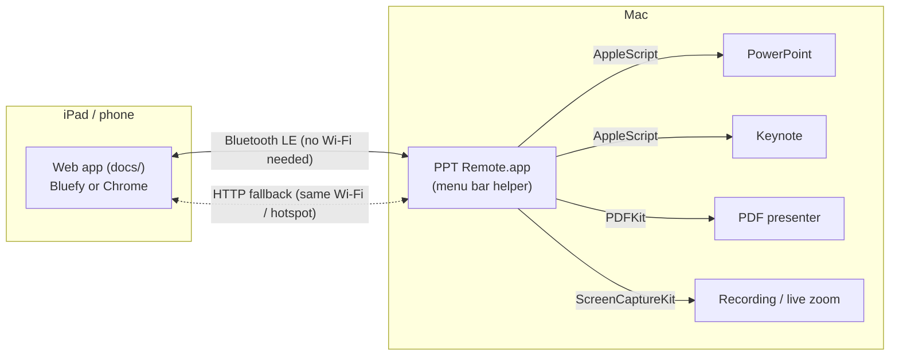

# PPT Remote – for developers

How the project is built, how the parts talk to each other, and how to work on it. For using the app, see the [README](README.md).



## Building the Mac helper

Only the Xcode Command Line Tools are needed (`xcode-select --install`); full Xcode is not required.

```bash
./mac-helper/build.sh                 # this Mac's architecture
UNIVERSAL=1 ./mac-helper/build.sh     # Apple silicon + Intel (used for releases)
open "mac-helper/build/PPT Remote.app"
```

- The app is signed ad hoc with a fixed designated requirement (its bundle identifier), so macOS keeps the Bluetooth, Automation, Accessibility, Microphone and Screen Recording permissions after a rebuild.
- If a permission seems stuck: `tccutil reset BluetoothAlways local.pptremote.helper` (or `AppleEvents`, `Accessibility`, `Microphone`, `ScreenCapture`) and start the app again.
- Subtitles use `SpeechAnalyzer`, which needs the macOS 26 SDK (Swift 6.2 or newer). With an older toolchain the app still builds, without subtitles.
- The build copies [docs/](docs/) into the app, so the helper can also serve the web app itself (network mode, *Open Remote in Browser*).

## The web app

[docs/](docs/) is a static site (HTML, CSS, plain JavaScript, no build step) hosted on GitHub Pages. Web Bluetooth only works on `https://` pages, hence Pages. Every push to `main` updates the live app. `docs/sw.js` is a network-first service worker; bump its cache name when files change.

To host your own copy: push this repository to GitHub, then *Settings › Pages › Deploy from a branch*, branch `main`, folder **/docs**.

## Releases

[.github/workflows/mac-app.yml](.github/workflows/mac-app.yml) builds the universal app on every push to `main` (as an artifact) and publishes a GitHub Release with `PPT-Remote-mac.zip` for every `v*` tag. It selects the newest Xcode on the runner, so subtitles are included.

## Project layout

| Path | Contents |
|---|---|
| [docs/index.html](docs/index.html), [docs/style.css](docs/style.css) | The remote's screens and layout (tablet, phone, phone sideways) |
| [docs/app.js](docs/app.js) | The remote: Bluetooth and network transports, state, slide images, notes, tools (laser, spotlight, zoom, pen, whiteboard), recording panel, soundboard, settings |
| [docs/remotemic.js](docs/remotemic.js) | The iPad / phone microphone: records in pieces, stores them on the device (IndexedDB), uploads in quiet moments over Bluetooth |
| [docs/protocol.js](docs/protocol.js) | Bluetooth message framing (shared format with the Mac) |
| [docs/storage.js](docs/storage.js) | Stored slides (IndexedDB) and image format detection |
| [docs/activity.js](docs/activity.js) | Activity log and transfer statistics |
| [docs/mictest.html](docs/mictest.html) | Stand-alone microphone test page |
| [mac-helper/Sources/main.swift](mac-helper/Sources/main.swift) | Menu bar app and its menu |
| [mac-helper/Sources/Hub.swift](mac-helper/Sources/Hub.swift) | Central model: which app is controlled, state, commands, deck loading |
| [mac-helper/Sources/PowerPoint.swift](mac-helper/Sources/PowerPoint.swift), [Keynote.swift](mac-helper/Sources/Keynote.swift), [PDFShow.swift](mac-helper/Sources/PDFShow.swift) | The three presentation sources (AppleScript for PowerPoint and Keynote; a built-in PDF presenter) |
| [mac-helper/Sources/SlideImages.swift](mac-helper/Sources/SlideImages.swift) | Slide PDF → AVIF / HEIC / JPEG images, content keys, slide titles, drawings-as-PDF export |
| [mac-helper/Sources/PointerOverlay.swift](mac-helper/Sources/PointerOverlay.swift), [LiveZoom.swift](mac-helper/Sources/LiveZoom.swift) | See-through window over the slide show: laser, ink, shapes, whiteboard, spotlight, live zoom |
| [mac-helper/Sources/Recorder.swift](mac-helper/Sources/Recorder.swift) | Lecture recording (ScreenCaptureKit), sound mixing, MP4 export |
| [mac-helper/Sources/AutoMix.swift](mac-helper/Sources/AutoMix.swift) | Lines the iPad's sound up with the MacBook's and picks the closest microphone |
| [mac-helper/Sources/RemoteMic.swift](mac-helper/Sources/RemoteMic.swift), [WebMOpus.swift](mac-helper/Sources/WebMOpus.swift) | Receiving and decoding the remote's microphone recording (WebM / Opus) |
| [mac-helper/Sources/Chapters.swift](mac-helper/Sources/Chapters.swift), [Subtitles.swift](mac-helper/Sources/Subtitles.swift) | Chapter and subtitle tracks in the MP4; on-device transcription |
| [mac-helper/Sources/BLEServer.swift](mac-helper/Sources/BLEServer.swift), [HTTPServer.swift](mac-helper/Sources/HTTPServer.swift), [Framing.swift](mac-helper/Sources/Framing.swift) | Bluetooth LE GATT server (one session per device) and the HTTP fallback |
| [mac-helper/Sources/SoundBoard.swift](mac-helper/Sources/SoundBoard.swift) | Soundboard (built-in sounds plus the user's Sounds folder) |
| [mac-helper/build.sh](mac-helper/build.sh) | Builds `PPT Remote.app` with `swiftc` |
| [mac-helper/Resources/](mac-helper/Resources/) | App icon and the built-in sounds |
| [tools/](tools/) | `make_sounds.py` synthesises the built-in sounds (needs numpy); `make_icon.swift` draws the app and web icons |
| [tests/](tests/) | Protocol tests, including a Swift ↔ JavaScript framing check |
| [screenshots/](screenshots/) | Images used in the README |

## Tests

```bash
node --test tests/*.test.js
```

## Bluetooth protocol

GATT service `2A4C9463-10DD-4D1D-9670-1C3D7737E942` with two characteristics.

**Command** `41D625BB-…` (write). UTF-8 text commands:

| Area | Commands |
|---|---|
| Session | `auth <pin> avif,heic,jpeg med` (PIN, image formats the device can show, quality), `hello`, `deck`, `quality low\|med\|high`, `fmt avif,jpeg` |
| Navigation | `next`, `prev`, `first`, `last`, `goto 5`, `start`, `starthere`, `end`, `black`, `reload` |
| Images | `img 3,4`, `imgclear` |
| Presentations | `use <id>` / `use auto` (PowerPoint, Keynote, PDF or recent PDF from the list) |
| Media | `media play\|pause\|stop\|seek\|rel <shape> [ms]` |
| Pointer (coordinates 0–10000 of the slide) | `lz x,y` / `lz off` (laser), `pd #rrggbb x,y`, `pm x,y;x,y…`, `pu` (pen), `sd line\|arrow\|ellipse\|rect #rrggbb x,y` + `sm x,y` (shapes), `sp x,y r` / `sp off` (spotlight, radius of the slide height), `zm x,y s` / `zm off` / `zm prep` (live zoom: centre and magnification ×100), `wb on\|off` (whiteboard), `ink clear` |
| Drawings PDF | `ink save`, `ink auto on\|off`, `ink pages all\|drawn` |
| Recording | `rec start\|pause\|resume\|stop\|savenow`, `rec screen auto\|<display id>`, `rec lang nl_NL\|en_GB\|…\|off` |
| Remote microphone | `ma begin\|end\|ask <rec> <seg> [bytes]`; audio arrives as binary writes `0x01, rec u32, seg u32, offset u32, bytes` |
| Soundboard | `sounds`, `snd play <id>`, `snd stop`, `snd vol 0.8` |

**Data** `C8CBD42E-…` (notify): framed messages `[type][msgId][seq u16][total u16][payload]`. Type 1 is JSON: `state`, `auth`, `noimage`, `deck`, `sounds` and `mack` (microphone upload acknowledgements). State messages only include notes that haven't been sent yet, and the list of open presentations only when it changes. The `deck` message holds the sections and a content key per slide (a hash of the rendered slide), which the device uses to find stored slides. Type 2 is an image: a JSON header line (`slide`, `deck`, `key`, `fmt`, `w`, `q`, `enc`) followed by the image bytes.

The HTTP fallback (port 8765) has the same commands via `/api/cmd?c=…`, plus `/api/state` (long poll), `/api/slide`, `/api/deck`, `/api/sounds` and `/api/auth`; the PIN goes in the `X-PPT-PIN` header or `?pin=`.

## README screenshots

The screenshots in [screenshots/](screenshots/) were made with a neutral demo deck (a PDF with sticky-note speaker notes) shown by the PDF presenter. The remote was captured with headless Chrome via `playwright-core` at iPad (1180×820, 2×) and phone (390×844, 3×) sizes. For the menu, start the helper with `PPTREMOTE_SHOW_MENU=<seconds>`: it opens its menu by itself after that many seconds, for six seconds. Pixelate the PIN, the network address and the QR code before publishing.
