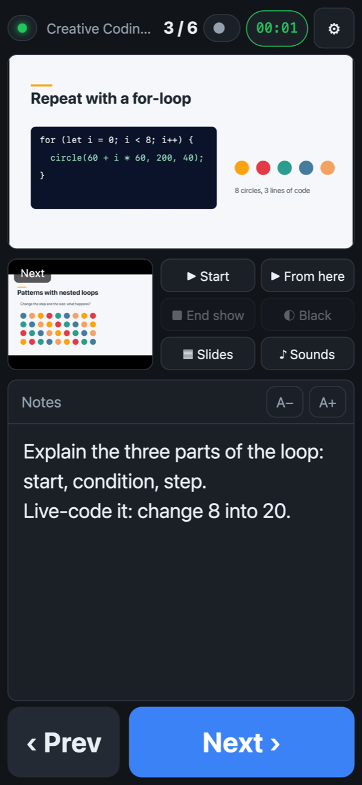
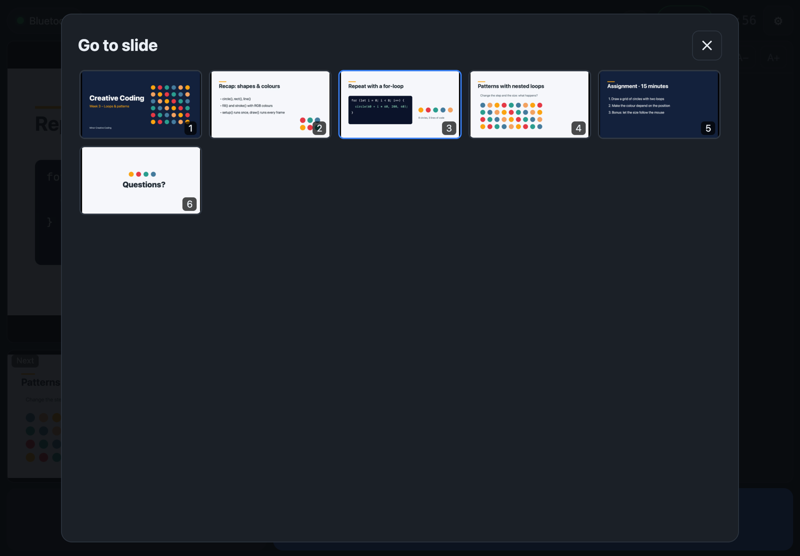
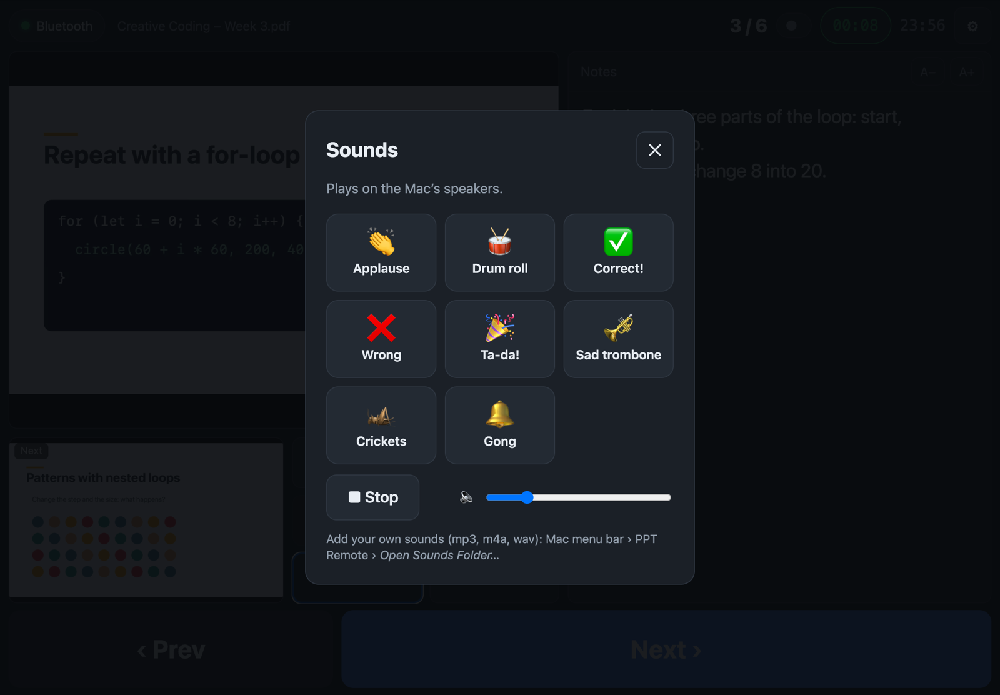
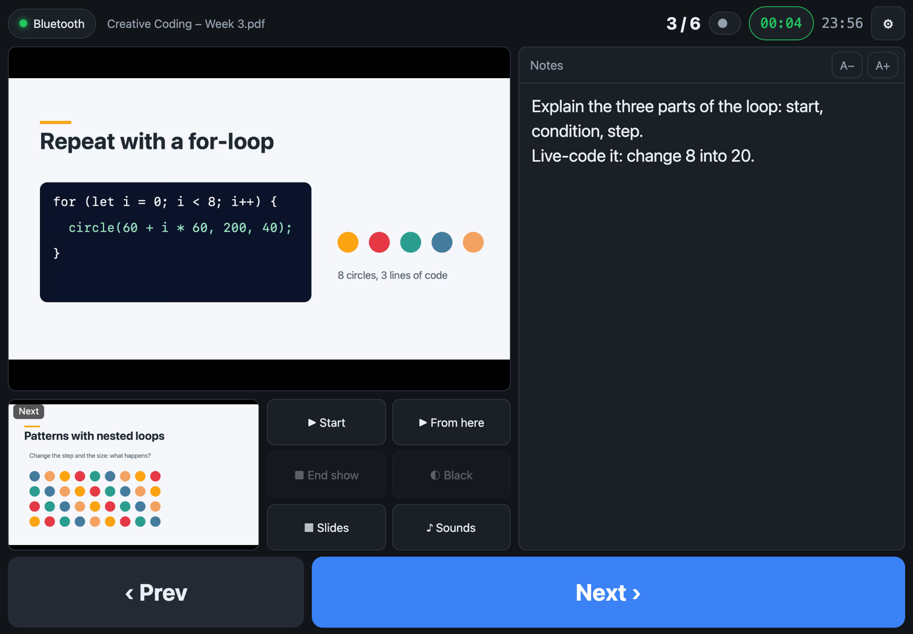
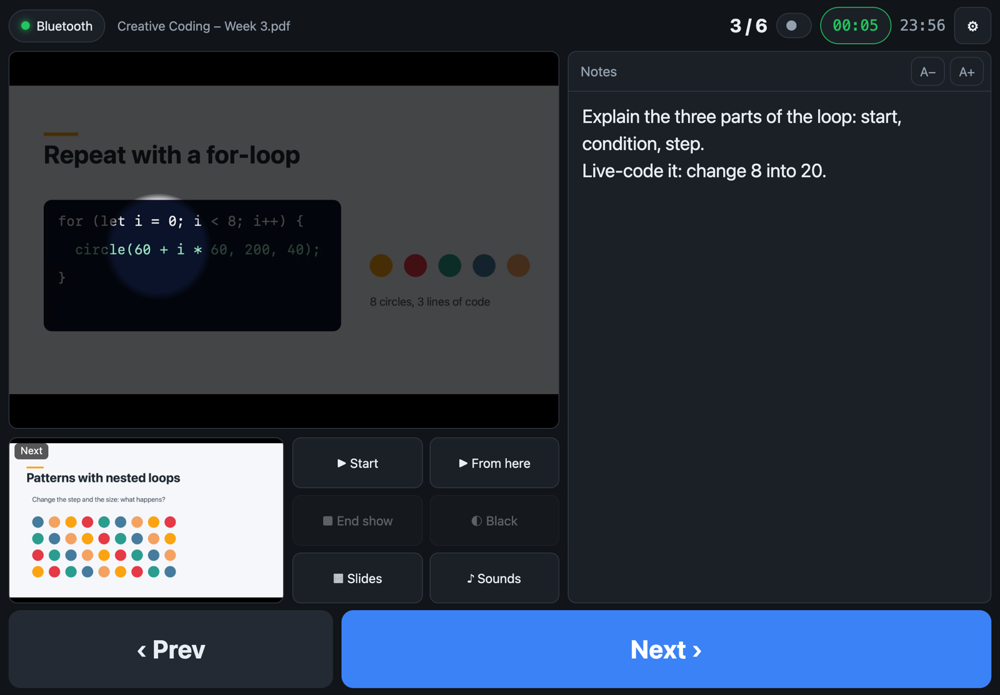
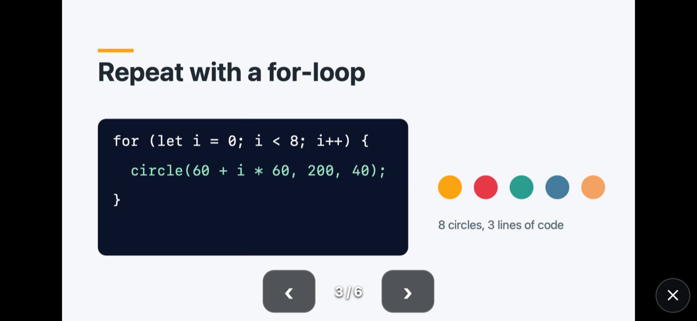
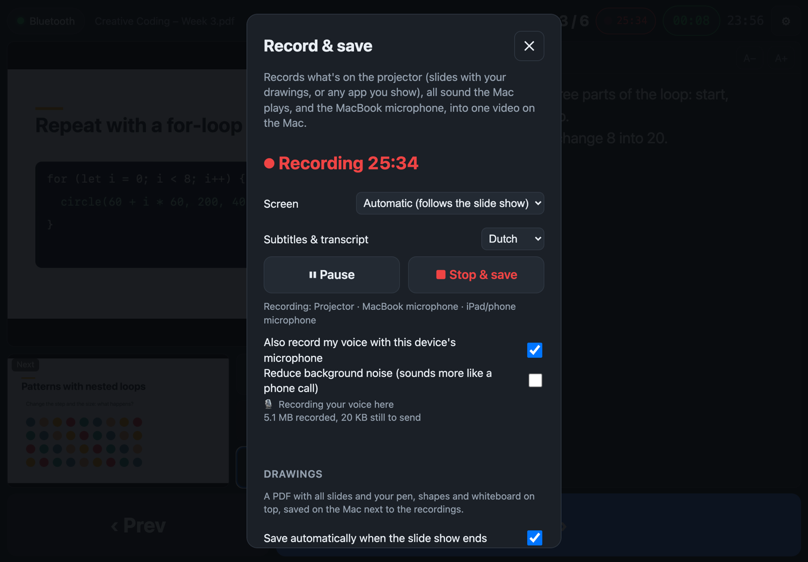
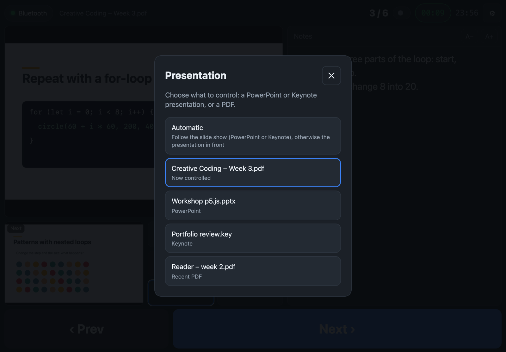
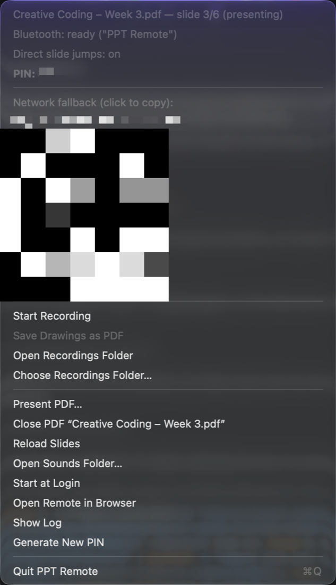
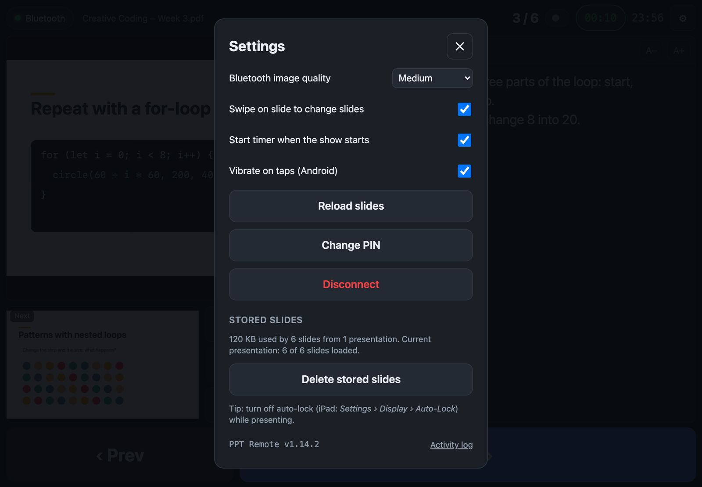

# PPT Remote

**Walk around the classroom and still control your slides.** Your iPad or phone shows the current and next slide and your speaker notes, and lets you change slides, point, draw and zoom on the projector. It works over **Bluetooth**, so it doesn't need the school Wi-Fi.

It works with **PowerPoint**, **Keynote** and **PDF** slides, on an iPad / iPhone (in the free Bluefy browser) or an Android phone (in Chrome). On the Mac, a small menu-bar app does the work. It can also **record your lecture** into a video with chapters and subtitles, ready to share.

  

## Contents

- [What you can do](#what-you-can-do)
- [Getting started](#getting-started) (about 5 minutes)
- [Using the remote](#using-the-remote)
- [Drawing, laser, spotlight and zoom](#drawing-laser-spotlight-and-zoom)
- [Recording a lecture](#recording-a-lecture)
- [Your drawings as a PDF](#your-drawings-as-a-pdf)
- [PowerPoint, Keynote and PDF](#powerpoint-keynote-and-pdf)
- [The menu-bar app on the Mac](#the-menu-bar-app-on-the-mac)
- [Settings](#settings)
- [Backup: network mode](#backup-network-mode)
- [Tips for the classroom](#tips-for-the-classroom)
- [Troubleshooting](#troubleshooting)
- [Privacy](#privacy)
- [For developers](#for-developers)

## What you can do

| | |
|---|---|
| **Present** | Current and next slide, your speaker notes (with formatting), big **Prev / Next** buttons, swipe, timer and clock |
| **Jump** | A slide grid (grouped by section) to go straight to any slide, without showing the slides in between |
| **Point and draw** | Laser pointer, spotlight, live zoom, pen, lines, arrows, circles, rectangles and a blank whiteboard, all shown on the projector |
| **Control** | Start, start from here, end, black screen, and play / pause videos in your slides |
| **Fun** | A soundboard (applause, drum roll, gong…) that plays on the Mac's speakers |
| **Record** | One video with the projector screen, the Mac's sound and your voice, with a chapter per slide, subtitles and a transcript |
| **Share** | Your slides with all your drawings as a PDF, saved automatically after the lesson |

## Getting started

### 1. Install the helper on your Mac

1. Download **PPT-Remote-mac.zip** from the [latest release](https://github.com/vincentsijben/powerpoint-remote/releases/latest), unzip it and move **PPT Remote** to your **Applications** folder. It runs on Apple silicon and Intel Macs, macOS 13 or newer.
2. Open it. The first time, macOS says it *cannot be opened*, because the app isn't notarised by Apple (that needs a paid developer account). Go to **System Settings › Privacy & Security**, scroll down and click **Open Anyway** next to "PPT Remote". You only do this once.
3. Allow the permissions macOS asks for:

| Permission | Why | Needed? |
|---|---|---|
| **Bluetooth** | So your iPad or phone can connect | Yes |
| **Automation** (control PowerPoint / Keynote) | To change slides and read your notes | Yes |
| **Accessibility** | Jump straight to a slide during the show; black screen in Keynote. Turn on via the menu › *Enable Direct Slide Jumps…* | Recommended |
| **Screen & System Audio Recording** | Live zoom and lecture recording. Turn on via the menu › *Enable Live Zoom…* | For zoom and recording |
| **Microphone** | Your voice in recordings | For recording |
| Incoming network connections | Only if the firewall asks; for network mode | Optional |

A new icon appears in the **menu bar** at the top of the screen. Click it to see the **PIN** you'll need on your iPad.

> **Tip:** turn on **Start at Login** in that menu, so the helper is always ready.

### 2. Open the remote on your iPad or phone

- **iPad / iPhone:** install the free **Bluefy – Web BLE Browser** from the App Store. Apple only lets this browser use Bluetooth for web pages. Open **https://vincentsijben.github.io/powerpoint-remote/** in Bluefy.
- **Android:** open the same address in **Chrome**. No extra app needed.

Tap **Connect via Bluetooth**, choose **PPT Remote** (on Android it may show your Mac's name), and type the PIN. The remote remembers the PIN.

> **Tip:** add the page to your home screen, and turn off auto-lock while you teach (iPad: *Settings › Display & Brightness › Auto-Lock › Never*).

### 3. Present

Open your presentation on the Mac, in PowerPoint or Keynote, or a PDF via the menu › *Present PDF…*. The remote shows it right away. Tap **▶︎ Start** and walk around.

## Using the remote

  

- **Top bar:** connection, the presentation's name (tap it to [choose another one](#powerpoint-keynote-and-pdf)), slide number, ⏺ [recording](#recording-a-lecture), timer, clock and ⚙︎ [settings](#settings).
- **Timer:** tap to start or pause, hold to reset. It can start by itself when the slide show starts.
- **Slides:** the current slide is big, the next one small (hidden slides are skipped). Swipe left or right on the slide to change slides.
- **Buttons:** **▶︎ Start** (from the beginning), **▶︎ From here**, **■ End show**, **◐ Black** (black screen; tap again or Next to come back), **▦ Slides** and **♪ Sounds**.
- **Notes:** your speaker notes, with bold, italic, colours and bullets as in PowerPoint. **A− / A+** change the text size. The current section is shown next to *Notes*.
- **Prev / Next:** like a clicker, Next first plays animations on the slide. On Android you feel a short vibration on each tap; if a tap doesn't reach the Mac, the remote shows a red warning.
- **Changes on the Mac** (keyboard, a presenter clicker, the mouse) show up on the remote right away.
- **Keyboard:** with a keyboard on the iPad, → / Space / Page Down go forward, ← / Page Up go back, and B gives a black screen.
- **Several devices** can be connected at the same time, for example an iPad and a phone. They all follow along.

### Slide grid

**▦ Slides** shows all slides, grouped by section. Tap one to go there. During the slide show the projector jumps straight to it; the audience doesn't see the slides in between (needs Accessibility, see above).

### Videos in your slides

When a slide has a video or sound, controls appear on the slide: play / pause, back to the start, and −10 / +10 seconds.

### Soundboard

**♪ Sounds** plays applause, a drum roll, correct, wrong, ta-da, a sad trombone, crickets or a gong on the **Mac's speakers**, so the whole room hears it. **■ Stop** stops it, and the slider sets the volume.

**Your own sounds:** Mac menu › *Open Sounds Folder…*, then drop mp3, m4a or wav files in it. They appear on the soundboard within a few seconds, named after the file.

## Drawing, laser, spotlight and zoom

During a slide show, round buttons appear on the slide. Everything you do with them appears on the projector.

| Button | What it does |
|---|---|
| ● **Laser** | A red dot where you touch |
| ◎ **Spotlight** | Darkens the slide except a bright circle where you point, like a spyglass. It stays where you leave it; **S / M / L** sets the size. Off on the next slide |
| ⊕ **Zoom** | Magnifies part of the slide, live. Drag a box, tap (2×), or pinch; drag to move around. **− / +** change the zoom, **1× ✕** shows the whole slide. Resets on the next slide |
| ✎ **Pen** | Draw freehand, or choose a straight line, arrow, circle or rectangle, in five colours |
| ▢ **Whiteboard** | A blank white page over the slide show to draw on. Tap again to go back; it keeps its drawings until the show ends |
| ⌫ **Erase** | Removes the drawings on this slide |
| ⤢ **Big slide** | The slide full screen on the remote, with small ‹ › buttons |

  
  

   
  <em>What the students see on the projector.</em>

- **Apple Pencil:** once you've used the Pencil, your hand resting on the screen no longer draws, selects or scrolls anything. Reload the page to draw with a finger again.
- **On a phone** the slide is small, so choosing ● or ✎ opens the big slide automatically. Turn the phone sideways and the slide fills the screen, with the tools beside it.

## Recording a lecture

Tap **⏺** in the top bar to open **Record & save**.

- **⏺ Start recording**, **⏸ Pause / Resume** and **■ Stop & save**. Stopping takes two taps, so it can't happen by accident. While recording, the ⏺ button in the top bar shows a pulsing red dot and the time.
- **What's recorded:** the projector screen (your slides with the drawings, laser and zoom, or VS Code or any other app you show), **all sound the Mac plays** (soundboard, videos in your slides) and the **MacBook microphone** (macOS 15 or newer).
- **Screen:** *Automatic* records the screen with the slide show, or with PowerPoint's window when no show is running, and follows the show to another screen. You can also choose a screen yourself, even while recording.
- **Your voice via the iPad or phone** (over Bluetooth): tick *Also record my voice with this device's microphone*. While you walk around, the iPad records your voice; at your desk the MacBook does (typing or using the trackpad counts as "at the desk"). When saving, the Mac lines both recordings up to the millisecond and always uses only the closest microphone, so your voice is never doubled. If the iPad's microphone stops (screen locked, other app), the MacBook fills the gap and the panel shows **🎙 Resume microphone**. *Reduce background noise* turns on the iPad's own noise filter. Keep the remote open with the screen on.
- **Saving** takes seconds. If the iPad still has sound to send, the panel shows *Receiving the iPad's sound…*; **Save now** skips that.
- **Before you start:** turn on **Do Not Disturb** on the Mac, so pop-ups don't end up in the video.

### What you get

Everything is saved in **Movies › PPT Remote** (choose another folder, for example on OneDrive, via the menu › *Choose Recordings Folder…*):

| File | What it is |
|---|---|
| `Lecture 2026-10-13 10.30 – Week 3.mp4` | The video, with **a chapter per slide** (named after the slide title) and the subtitles built in. QuickTime Player and VLC show both in their menus |
| `… .chapters.txt` | Chapter times, to paste into a YouTube or Stream description |
| `… .srt` and `… .vtt` | Subtitles to upload: `.srt` for YouTube, `.vtt` for Microsoft Stream / Teams |
| `… – transcript.txt` | Everything you said, per slide |
| `Drawings … .pdf` | Your [drawings](#your-drawings-as-a-pdf) |

**Subtitles and transcript** are made on the Mac itself; nothing is uploaded. They need macOS 26 or newer and take about 2 minutes per hour of lecture. You can already use the video meanwhile. Choose the language in the panel: Dutch, English, German, French, Spanish, or *Off*. Speech recognition makes mistakes now and then, so check the subtitles before sharing them widely.

## Your drawings as a PDF

When a slide show with drawings ends, the Mac saves a PDF with all slides and your pen, shapes and whiteboard on top, next to the recordings. The slides stay sharp and their text can still be selected, so it's ready to share with students. In **⏺ › Drawings** you can turn this off, choose *Only slides with drawings*, or save right away. The Mac menu has *Save Drawings as PDF* too.

## PowerPoint, Keynote and PDF

Tap the presentation's name at the top of the remote to choose what to control.

- **Automatic** follows the app with a running slide show, PowerPoint or Keynote; otherwise it follows the presentation in front.
- **PowerPoint:** everything works, including formatted notes, sections and videos.
- **Keynote:** slides, presenter notes, skipped slides, all drawing tools and recording. Black screen needs Accessibility. Formatted notes and video controls aren't available for Keynote.
- **PDF** (slides from Canva, Google Slides, LaTeX or a reader): open it via the Mac menu › *Present PDF…*, *Open With › PPT Remote* in Finder, or pick it under *Recent PDF* in this list. The Mac shows it full screen, on the projector when one is connected. Sticky notes (comments) on a page are its speaker notes. A presenter clicker or the keyboard also works: arrows or Page Up / Down to change slides, Esc ends, B for a black screen.

## The menu-bar app on the Mac

| Menu item | What it does |
|---|---|
| *(status lines)* | The presentation and slide, Bluetooth, direct slide jumps and the **PIN** |
| *Enable Direct Slide Jumps… / Enable Live Zoom…* | Shown when a permission is missing; opens the right page in System Settings |
| *Network fallback* + QR code | The address for [network mode](#backup-network-mode); click to copy, or scan the QR code with the iPad |
| *Start / Pause / Stop and Save Recording* | Recording without the remote |
| *Save Drawings as PDF* | Saves the drawings of the current or last slide show |
| *Open Recordings Folder / Choose Recordings Folder…* | Where recordings and drawings go |
| *Present PDF… / Close PDF* | The built-in PDF presenter |
| *Reload Slides* | Fetches the slides again after you edit them |
| *Open Sounds Folder…* | Add your own sounds to the soundboard |
| *Start at Login* | Start the helper automatically |
| *Open Remote in Browser* | The remote on the Mac itself, handy for testing |
| *Show Log* | What the helper did, for troubleshooting |
| *Generate New PIN* | A new PIN; all remotes have to log in again |

## Settings

- **Bluetooth image quality:** Low is fastest, High is sharpest. In network mode slides are always sharp.
- **Swipe on slide**, **Start timer when the show starts**, **Vibrate on taps** (Android).
- **Reload slides:** after you edit your presentation. Notes update by themselves.
- **Change PIN** and **Disconnect**.
- **Stored slides:** slides are kept on the device, so reconnecting is instant and only changed slides are sent again (usually a few hundred KB per presentation; old ones are removed above 150 MB). *Delete stored slides* clears them.
- **Activity log** (bottom right): what happens behind the scenes, such as the connection, every slide image with its size and speed, and data sent and received. *Copy* puts it on the clipboard, for example to send with a question.

## Backup: network mode

If Bluetooth gives you trouble, the remote can also connect over a network. School Wi-Fi such as eduroam usually blocks devices from talking to each other, so use your **iPhone's Personal Hotspot**: connect both the Mac and the iPad to it. This uses almost no mobile data, because the traffic stays between your devices. Then scan the **QR code** in the Mac menu with the iPad's camera, or type the address shown there. Network mode works in any browser and shows sharper slide images.

## Tips for the classroom

- Bluetooth reaches about 10 to 20 metres in a classroom; walls reduce that.
- PowerPoint's Presenter View on the Mac works as usual.
- Keep the mouse pointer off the projector during the show. Otherwise PowerPoint shows its own buttons at the bottom of the slide.
- The first tap after a black screen brings the slide back, just like a clicker.
- Turn on Do Not Disturb before you record.

## Troubleshooting

| Problem | What to do |
|---|---|
| "PPT Remote" doesn't appear in Bluefy | Check that the Mac menu says *Bluetooth: ready*. Turn Bluetooth off and on on the iPad, or quit and reopen the helper |
| Only slide numbers, no images | The Mac is still exporting the slides (the menu says *loading…*). Try *Reload Slides* and check *⚙︎ › Activity log* |
| Jumping shows all slides in between | Turn on Accessibility: menu › *Enable Direct Slide Jumps…*. The menu then says *Direct slide jumps: on* |
| PowerPoint or Keynote doesn't react | *System Settings › Privacy & Security › Automation › PPT Remote*: turn on Microsoft PowerPoint / Keynote |
| Zoom or recording doesn't work | Turn on Screen & System Audio Recording: menu › *Enable Live Zoom…*. macOS may ask to quit and reopen PPT Remote |
| The recording shows the wrong screen | In ⏺, choose the screen yourself instead of *Automatic* |
| My voice is missing from the recording | Allow the microphone for PPT Remote (*System Settings › Privacy & Security › Microphone*). The MacBook microphone needs macOS 15 or newer |
| The iPad's microphone stops | iPadOS stops it when the screen locks or you switch apps. Tap *🎙 Resume microphone*; the MacBook covers the gap |
| No subtitles | They need macOS 26 or newer, and a language other than *Off* in ⏺ |
| Old slide images after editing | *⚙︎ › Reload slides*; if that doesn't help, *Delete stored slides* |
| Wrong PIN | The PIN is in the Mac menu. *Generate New PIN* logs out all remotes |
| Anything else | Menu › *Show Log*, and *⚙︎ › Activity log* on the remote |

## Privacy

- Everything stays on your own devices. Slides, notes, recordings, transcripts and drawings are never uploaded; speech recognition runs on the Mac itself.
- The connection is protected by a 4-digit PIN, so students can't take over.
- The only thing loaded from the internet is the remote's web page, from GitHub Pages.
- When you record students, tell them beforehand and follow your school's rules for recording lessons.

## For developers

Building the app yourself, the project layout, the Bluetooth protocol and how the screenshots were made: see **[DEVELOPMENT.md](DEVELOPMENT.md)**.
