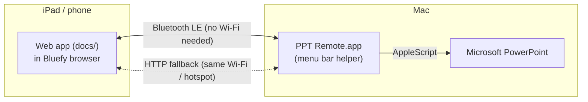

# PPT Remote

Control PowerPoint on your Mac from an iPad or phone: see the current and next slide, read your speaker notes, and go forward or back while you walk around the room. It works over **Bluetooth**, so you don't need the school Wi-Fi. A **network mode** is there as a backup (for example over your iPhone's hotspot). It works on iPad/iPhone (in the Bluefy browser) and Android (in Chrome).



## What it does

- Big **Prev / Next** buttons. You can also swipe on the slide.
- Shows the current slide, a preview of the next one, and your **speaker notes** (text size adjustable).
- **Start** (from the beginning or from the current slide), **End show**, **Black screen**, and a **slide grid** to jump to any slide.
- A presentation timer and a clock.
- Follows changes you make on the Mac itself (keyboard, clicker, mouse).
- Protected by a 4-digit **PIN** so students can't take over.
- **Jumps straight to a slide** from the slide grid, so the audience doesn't see the slides in between.
- Small **AVIF** slide images (about 5× smaller than JPEG), **stored on the device**, so reconnecting is instant and only changed slides are sent again.
- An **activity log** (⚙︎ › *Activity log*) shows what happens behind the scenes: images being fetched, sizes, speed, and data transferred.
- **Several presentations open?** Tap the presentation name at the top to choose which one to control. *Automatic* follows PowerPoint: the presentation in the slide show, or the one in front.
- **Laser pointer, pen and shapes** during a slide show: tap ● or ✎ on the slide, then touch or draw. The red dot and the drawings appear on the projector. With ✎ you can also pick a straight line, arrow, circle or rectangle, in five colours. ⌫ erases the drawings on that slide. **Palm rejection:** once you've used an Apple Pencil (or another stylus), finger and palm touches no longer draw, and a hand resting on the screen doesn't select or scroll anything (reload the page to draw with a finger again).
- **Spotlight** (◎): darkens the whole slide except a bright circle where you point, like a spyglass. The circle stays where you leave it, so you can talk about that part; S / M / L sets its size. It switches off on the next slide.
- **Zoom** (⊕): magnify part of the slide on the projector, live. Drag a box around the part you want, tap to zoom 2× there, or pinch with two fingers; drag to move around. − / + change the magnification and *1× ✕* shows the whole slide again. You can switch to the laser, spotlight or pen while zoomed in; drawings stay in place on the slide. The zoom resets on the next slide. Needs the Screen Recording permission on the Mac.
- **Record the lecture** (⏺ in the top bar): one MP4 with what's on the projector (slides with your drawings, or VS Code / any app you show), all sound the Mac plays (soundboard, videos in the slides) and the MacBook microphone. It records the screen with the slide show; when no show runs, the screen with PowerPoint's window. In *Automatic* mode it follows the slide show if you start it on another screen; after the show ends it stays on that screen, so switching to VS Code on the projector is recorded too. You can also pick a screen in the Record panel, even while recording. The video gets **a chapter per slide** (named after the slide's title, plus *Whiteboard* and *Mac screen*), shown as a chapter menu in QuickTime Player, VLC and IINA; slides you skip through in under 3 seconds are left out. A `.chapters.txt` file with timestamps comes along: paste it into a YouTube or Stream description to get chapters there too. Pause and resume from the remote; stopping takes two taps so it can't happen by accident. The microphone is turned down automatically while the Mac plays sound, so it isn't heard twice. Saving takes seconds. Recordings go to *Movies/PPT Remote*; choose another folder (for example OneDrive) via the menu bar › *Choose Recordings Folder…*. Tip: turn on Do Not Disturb on the Mac first.
  - **Your voice via the iPad / phone** (Bluetooth only): in the Record panel, turn on *Also record my voice with this device's microphone*. The remote then records while the Mac records, keeps the sound on the device, and sends it to the Mac in quiet moments (slides and pen go first); after Stop the rest is sent and the Mac waits for it (*Save now* skips that). When saving, the Mac lines the iPad's sound up with the MacBook's to the millisecond (start offset and clock drift, measured from your voice in both), then picks per moment the microphone you're closest to: the iPad while you walk around, the MacBook while you're at your desk (typing or using the trackpad counts as "at the desk"). Only one microphone is heard at a time, with a short crossfade, so your voice isn't doubled; when the iPad's microphone was stopped (screen locked, other app), the MacBook fills the gap. The Record panel shows how the voice was put together. Keep the remote open with the screen on: iPadOS stops the microphone otherwise.
- **Drawings as a PDF**: when a slide show with drawings ends, the Mac saves a PDF with all slides and your pen, shapes and whiteboard on top (the slides stay sharp and their text selectable), next to the recordings, ready to share with students. In the remote's ⏺ panel you can turn this off, choose *Only slides with drawings*, or save right away; the Mac menu has *Save Drawings as PDF* too.
- **Whiteboard** (▢): a blank white page over the slide show to draw on. Tap ▢ again to go back to the slide; the whiteboard keeps its drawings until the show ends.
- **Big slide** for drawing on a phone: choosing ● or ✎ on a phone, or tapping ⤢, shows the slide full screen with small ‹ › buttons. Turn the phone sideways and the slide fills the screen automatically, with the tools in the black bars beside it.
- **Soundboard** (♪ Sounds): applause, drum roll, correct, wrong, ta-da, sad trombone, crickets and a gong, played on the **Mac's speakers**. You can add your own sounds (see below).
- **Clear feedback**: a short vibration when you tap Next/Prev (Android). If a command doesn't reach the Mac, you get a red warning plus a longer vibration.
- **Video and audio controls** when a slide has media: play/pause, back to the start, and −10 / +10 seconds.
- **Slides grouped by section** in the slide grid, and the current section is shown next to *Notes*.
- **Formatted notes**: bold, italic, underline, colours and bullet lists, as in PowerPoint. Plain notes appear right away. The formatting follows a moment later, because it is read in the background.

## 1. Mac: install the helper

**Easiest:** download **PPT-Remote-mac.zip** from the [latest release](https://github.com/vincentsijben/powerpoint-remote/releases/latest), unzip it and move **PPT Remote** to your *Applications* folder. It runs on Apple silicon and Intel Macs (macOS 13 or newer).

The app isn't notarised by Apple (that requires a paid developer account), so the first time macOS says it *cannot be opened*. To allow it, open **System Settings › Privacy & Security**, scroll down and click **Open Anyway** next to "PPT Remote". You only need to do this once.

**Or build it yourself.** You only need the Xcode Command Line Tools (`xcode-select --install`); full Xcode is not required.

```bash
./mac-helper/build.sh
open "mac-helper/build/PPT Remote.app"
```

The first time it runs, macOS asks for some permissions. Allow all of them:

- **Bluetooth**: so the iPad or phone can connect.
- **Control "Microsoft PowerPoint"** (Automation): to change slides and read notes.
- **Incoming network connections** (only if the firewall asks): needed for network mode.
- **Accessibility** (optional): lets the helper jump straight to a slide during a slide show. PowerPoint's scripting can only step one slide at a time, so the helper types the slide number + Return for you. Turn it on via the menu item *Enable Direct Slide Jumps…*. Without it, jumps still work, but the projector briefly shows every slide in between. The laser pointer and pen don't need this permission: the helper draws them in its own see-through window on top of the slide show.
- **Microphone** (optional): your voice in lecture recordings.
- **Screen Recording** (optional): needed for *live zoom* and *recording*. The helper magnifies what's on the slide show screen (including builds and playing videos) without recording or saving anything. Turn it on via the menu item *Enable Live Zoom…*; macOS may ask to quit and reopen PPT Remote. While zoomed in, and for 20 seconds after, macOS shows its screen-recording icon in the menu bar.

A new icon shows up in the **menu bar**. Click it to see:

- the PowerPoint status,
- the Bluetooth status,
- the **PIN**,
- the network address with a QR code.

Tip: with the app in *Applications*, turn on **Start at Login** in its menu so it is always ready.

**Your own sounds:** choose *Open Sounds Folder…* in the menu and drop mp3, m4a or wav files in it (for example a real applause recording). They appear on the soundboard within a few seconds, named after the file.

> The app is signed with a fixed identifier, so permissions stay valid after rebuilding.
> If a permission seems stuck, run `tccutil reset BluetoothAlways local.pptremote.helper` (or `AppleEvents` / `Accessibility` / `ScreenCapture`) and start the app again.

## 2. The web app (already online)

The app is live at **https://vincentsijben.github.io/powerpoint-remote/**

On iPad and iPhone, Safari, Chrome and every other browser block Bluetooth for web pages. The free **Bluefy – Web BLE Browser** app (App Store) is the exception. Chrome on Android supports it out of the box. Web Bluetooth also requires an `https://` page, which is why the [docs/](docs/) folder is hosted on **GitHub Pages**. Every push to `main` updates the live app. To host your own copy instead:

1. Create a GitHub repository (for example `powerpoint-remote`) and push this folder to it.
2. On GitHub, go to *Settings › Pages*, choose **Deploy from a branch**, branch `main`, folder **/docs**, and save.
3. After a minute the app is live at `https://<your-username>.github.io/<repo>/`.

The iPad or phone only needs internet the first time it loads the page (or after updates). The connection to the Mac itself goes over Bluetooth.

## 3. iPad, iPhone or Android: connect over Bluetooth

1. **iPad/iPhone:** install **Bluefy – Web BLE Browser** from the App Store and open https://vincentsijben.github.io/powerpoint-remote/ in it.
   **Android:** open the same address in **Chrome**. Chrome supports Bluetooth for web pages, so no extra app is needed.
2. Tap **Connect via Bluetooth** and choose **PPT Remote**. On Android the Mac may show up as your Mac's name.
3. Enter the PIN from the Mac menu bar. It is remembered after that.

Slide images are preloaded in the background, starting with the current and next slide. Over Bluetooth this takes about 0.2–0.7 seconds per slide. Notes and next/prev arrive right away. If images feel slow, set *Settings › Bluetooth image quality* to **Low**.

Slides are **stored on the device**. The next time you connect with the same presentation, they show up instantly. After you edit a presentation, only the changed slides are sent again. *⚙︎ › Stored slides* shows how much space this uses (usually a few hundred KB per presentation) and has a button to delete them. Old slides are removed automatically when storage goes over 150 MB.

Want to see what's going on? Open *⚙︎ › Activity log*. It shows the connection, data received and sent, the current speed, and how many slides are on the device. It also lists every image fetched, with its size, format and how long it took.

## Backup: network mode (any browser)

If Bluetooth gives you trouble, put the Mac and iPad on the **same network**. School Wi-Fi often blocks devices from talking to each other, so the most reliable choice is your **iPhone's Personal Hotspot**. Connect both the Mac and the iPad to it. This uses almost no mobile data, because traffic stays between your devices.

Next, scan the **QR code** in the Mac menu bar with the iPad camera, or type the address shown there (for example `http://172.20.10.2:8765/?pin=1234`). The app connects on its own in Safari. Network mode shows higher-quality slide images.

## Tips for the classroom

- Turn off auto-lock while you present (iPad: **Settings › Display & Brightness › Auto-Lock** › *Never*).
- Keep the Mac's Bluetooth on. You have about 10 m of range, and walls reduce it.
- PowerPoint's Presenter View on the Mac works as usual.
- After you edit slides, tap **⚙︎ › Reload slides from PowerPoint** to refresh the images. Notes update on their own.
- With animations, **Next** steps through the animation builds first, just like a clicker.
- Hidden slides are labelled and skipped in the "next" preview during the show.
- Several devices can be connected at once (for example an iPad and a phone). Each one gets its own slide images, quality and format. Anything that changes PowerPoint (next/previous, jump, black screen, *Reload slides*, laser/pen, video) is shared, so all connected devices follow along.

## Troubleshooting

| Problem | What to do |
|---|---|
| "PPT Remote" doesn't show up in Bluefy | Check the menu bar says *Bluetooth: ready*. Turn Bluetooth off and on again on the iPad. Quit and reopen the helper. |
| No slide images, only numbers | The menu shows *loading…* while slides export. Try **Reload Slides from PowerPoint** in the menu. Check *⚙︎ › Activity log* on the iPad or phone. |
| Jumping to a slide shows all slides in between | Turn on Accessibility for PPT Remote (menu › *Enable Direct Slide Jumps…*). The menu then says *Direct slide jumps: on*. |
| Slide images stay empty on one device | Open *⚙︎ › Activity log*. If the device can't display a format, it says *switching to JPEG* and fetches the slides again by itself. |
| Old slide images after editing | Tap **⚙︎ › Reload slides from PowerPoint**. If that doesn't help, use *Delete stored slides*. |
| PowerPoint doesn't react | Check *System Settings › Privacy & Security › Automation › PPT Remote › Microsoft PowerPoint* is on. |
| Wrong PIN | The PIN is in the Mac menu. *Generate New PIN* logs out all remotes. |
| Anything else | Menu › **Show Log** (`~/Library/Logs/PPTRemote.log`). |

## Project layout

| Path | Contents |
|---|---|
| [docs/](docs/) | Web app for iPad and phones (static: HTML/CSS/JS, deployable to GitHub Pages) |
| [docs/protocol.js](docs/protocol.js) | Bluetooth message framing (shared format with the Mac) |
| [docs/storage.js](docs/storage.js) | Stored slides (IndexedDB) and image format detection |
| [docs/activity.js](docs/activity.js) | Activity log and transfer statistics |
| [mac-helper/Sources/](mac-helper/Sources/) | Swift menu bar helper: PowerPoint control (AppleScript), slide rendering (PDF → AVIF/HEIC/JPEG), Bluetooth LE GATT server, HTTP server |
| [mac-helper/build.sh](mac-helper/build.sh) | Builds `PPT Remote.app` with `swiftc` |
| [mac-helper/Resources/](mac-helper/Resources/) | App icon and the built-in sounds |
| [tools/](tools/) | `make_sounds.py` synthesises the built-in sounds (needs numpy); `make_icon.swift` draws the app and web icons |
| [.github/workflows/mac-app.yml](.github/workflows/mac-app.yml) | Builds the universal app on GitHub; a `v*` tag publishes it as a release |
| [tests/](tests/) | Protocol tests, including a Swift ↔ JavaScript framing check |

Run the tests with:

```bash
node --test tests/*.test.js
```

### Bluetooth protocol (for the curious)

The helper uses GATT service `2A4C9463-10DD-4D1D-9670-1C3D7737E942` with two characteristics:

- **Command** `41D625BB-…` (write): UTF-8 text commands such as `auth 1234 avif,heic,jpeg med` (PIN, image formats the device can show, quality), `next`, `prev`, `goto 5`, `start`, `starthere`, `end`, `black`, `reload`, `img 3,4`, `imgclear`, `quality low|med|high`, `fmt avif,jpeg`, `deck`, `hello`, `use <id>|auto` (choose presentation), `media play|pause|stop|seek|rel <shape> [ms]`, pointer messages `lz x,y` / `lz off` (laser), `pd #rrggbb x,y`, `pm x,y;x,y…`, `pu` (pen, coordinates 0–10000), `sd line|arrow|ellipse|rect #rrggbb x,y` + `sm x,y` (shapes), `ink clear`, `sp x,y r` / `sp off` (spotlight, radius 0–10000 of the slide height), `zm x,y s` / `zm off` / `zm prep` (live zoom: centre of the visible part and magnification ×100), `rec start|pause|resume|stop` (lecture recording), `ink save` / `ink auto on|off` / `ink pages all|drawn` (drawings as PDF), `wb on|off` (whiteboard), and `sounds`, `snd play <id>`, `snd stop`, `snd vol 0.8` (soundboard).
- **Data** `C8CBD42E-…` (notify): framed messages `[type][msgId][seq u16][total u16][payload]`. Type 1 is JSON: `state`, `auth`, `noimage`, and `deck`. State messages only include notes that haven't been sent yet, and the list of open presentations only when it changes. The `deck` message holds the sections and a content key per slide (a hash of the rendered slide), which the device uses to find stored slides. Type 2 is an image: a JSON header line (`slide`, `deck`, `key`, `fmt`, `w`, `q`, `enc`) followed by the image bytes in AVIF, HEIC or JPEG.
