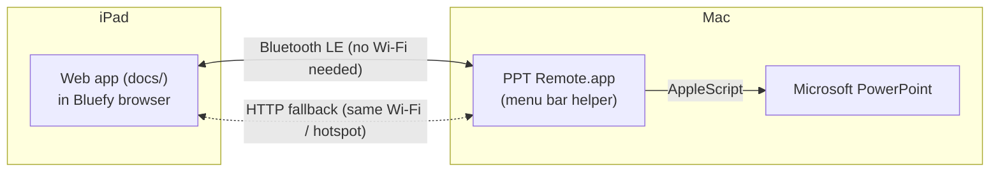

# PPT Remote

Control PowerPoint on your Mac from an iPad: see the current and next slide, read your speaker notes, and go forward or back while you walk around the room. It works over **Bluetooth**, so you don't need the school Wi-Fi. A **network mode** is there as a backup (for example over your iPhone's hotspot).



## What it does

- Big **Prev / Next** buttons. You can also swipe on the slide.
- Shows the current slide, a preview of the next one, and your **speaker notes** (text size adjustable).
- **Start** (from the beginning or from the current slide), **End show**, **Black screen**, and a **slide grid** to jump to any slide.
- A presentation timer and a clock.
- Follows changes you make on the Mac itself (keyboard, clicker, mouse).
- Protected by a 4-digit **PIN** so students can't take over.

## 1. Mac: build and start the helper

You only need the Xcode Command Line Tools (`xcode-select --install`). Full Xcode is not required.

```bash
./mac-helper/build.sh
open "mac-helper/build/PPT Remote.app"
```

The first time it runs, macOS asks for some permissions. Allow all of them:

- **Bluetooth**: so the iPad can connect.
- **Control "Microsoft PowerPoint"** (Automation): to change slides and read notes.
- **Incoming network connections** (only if the firewall asks): needed for network mode.

A new icon shows up in the **menu bar**. Click it to see:

- the PowerPoint status,
- the Bluetooth status,
- the **PIN**,
- the network address with a QR code.

Tip: copy the app to `/Applications` and add it under *System Settings › General › Login Items* so it starts on its own.

> Every rebuild changes the app's ad-hoc signature, so macOS may ask for Bluetooth/Automation permission again.
> If a permission seems stuck, run: `tccutil reset BluetoothAlways local.pptremote.helper` and `tccutil reset AppleEvents local.pptremote.helper`.

## 2. The web app (already online)

The iPad app is live at **https://vincentsijben.github.io/powerpoint-remote/**

Safari, Chrome, and every other iPad browser block Bluetooth for web pages. The free **Bluefy – Web BLE Browser** app (App Store) is the exception. Web Bluetooth also requires an `https://` page, which is why the [docs/](docs/) folder is hosted on **GitHub Pages**. Every push to `main` updates the live app. To host your own copy instead:

1. Create a GitHub repository (for example `powerpoint-remote`) and push this folder to it.
2. On GitHub, go to *Settings › Pages*, choose **Deploy from a branch**, branch `main`, folder **/docs**, and save.
3. After a minute the app is live at `https://<your-username>.github.io/<repo>/`.

The iPad only needs internet the first time it loads the page (or after updates). The connection to the Mac itself goes over Bluetooth.

## 3. iPad: connect over Bluetooth

1. Install **Bluefy – Web BLE Browser** from the App Store.
2. Open https://vincentsijben.github.io/powerpoint-remote/ in Bluefy.
3. Tap **Connect via Bluetooth** and choose **PPT Remote**.
4. Enter the PIN from the Mac menu bar. It is remembered after that.

Slide images reach the iPad at about 1–2 seconds per slide. They are all preloaded in the background, starting with the current and next slide. Notes and next/prev arrive right away. If images feel slow, set *Settings › Bluetooth image quality* to **Low**.

## Backup: network mode (any browser)

If Bluetooth gives you trouble, put the Mac and iPad on the **same network**. School Wi-Fi often blocks devices from talking to each other, so the most reliable choice is your **iPhone's Personal Hotspot**. Connect both the Mac and the iPad to it. This uses almost no mobile data, because traffic stays between your devices.

Next, scan the **QR code** in the Mac menu bar with the iPad camera, or type the address shown there (for example `http://172.20.10.2:8765/?pin=1234`). The app connects on its own in Safari. Network mode shows higher-quality slide images.

## Tips for the classroom

- Set iPad **Settings › Display & Brightness › Auto-Lock** to *Never* while you present.
- Keep the Mac's Bluetooth on. You have about 10 m of range, and walls reduce it.
- PowerPoint's Presenter View on the Mac works as usual.
- After you edit slides, tap **⚙︎ › Reload slides from PowerPoint** to refresh the images. Notes update on their own.
- With animations, **Next** steps through the animation builds first, just like a clicker.
- Hidden slides are labelled and skipped in the "next" preview during the show.

## Troubleshooting

| Problem | What to do |
|---|---|
| "PPT Remote" doesn't show up in Bluefy | Check the menu bar says *Bluetooth: ready*. Turn Bluetooth off and on again on the iPad. Quit and reopen the helper. |
| No slide images, only numbers | The menu shows *loading…* while slides export. Try **Reload Slides from PowerPoint** in the menu. |
| PowerPoint doesn't react | Check *System Settings › Privacy & Security › Automation › PPT Remote › Microsoft PowerPoint* is on. |
| Wrong PIN | The PIN is in the Mac menu. *Generate New PIN* logs out all remotes. |
| Anything else | Menu › **Show Log** (`~/Library/Logs/PPTRemote.log`). |

## Project layout

| Path | Contents |
|---|---|
| [docs/](docs/) | iPad web app (static: HTML/CSS/JS, deployable to GitHub Pages) |
| [docs/protocol.js](docs/protocol.js) | Bluetooth message framing (shared format with the Mac) |
| [mac-helper/Sources/](mac-helper/Sources/) | Swift menu bar helper: PowerPoint control (AppleScript), slide rendering (PDF → JPEG), Bluetooth LE GATT server, HTTP server |
| [mac-helper/build.sh](mac-helper/build.sh) | Builds `PPT Remote.app` with `swiftc` |
| [tests/](tests/) | Protocol tests, including a Swift ↔ JavaScript framing check |

Run the tests with:

```bash
node --test tests/*.test.js
```

### Bluetooth protocol (for the curious)

The helper uses GATT service `2A4C9463-10DD-4D1D-9670-1C3D7737E942` with two characteristics:

- **Command** `41D625BB-…` (write): UTF-8 text commands such as `auth 1234`, `next`, `prev`, `goto 5`, `start`, `starthere`, `end`, `black`, `reload`, `img 3,4`, `imgclear`, `quality low|med|high`, `hello`.
- **Data** `C8CBD42E-…` (notify): framed messages `[type][msgId][seq u16][total u16][payload]`. Type 1 is JSON (state, auth). Type 2 is an image: a JSON header line followed by the JPEG bytes.
